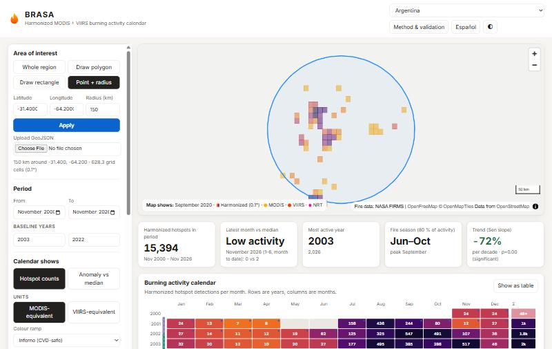

# BRASA: Burning Records Across Satellites, Aligned

**A harmonized MODIS + VIIRS burning activity calendar for any area of interest, 2000 to today.**

**Live demo → https://theexotech.github.io/brasa/** · [Method & validation](https://theexotech.github.io/brasa/method.html)

Built for the NASA Space Apps Challenge 2026 challenge [*Harmonization of MODIS and VIIRS Hot Spots*](https://www.spaceappschallenge.org/2026/challenges/modis-and-viirs-hot-spots/).

> MODIS has watched fires since 2000 but is retiring. VIIRS carries the record forward with pixels that detect **5× (Argentina) to 10× (Philippines) more hotspots**. Splice the two and the fire record shows a fake **+430 % to +900 % jump**. BRASA removes the jump, with **≈1 % bias and R² ≈ 0.97–0.98** in cross-validation. Fire managers get one consistent calendar in which the sensor no longer matters.



## What it does
- **Harmonized calendar (year × month heatmap)** from Nov 2000 to the current month. Shows annual totals, the baseline median row, the data source era, and uncertainty and incomplete-data marks.
- **Any area of interest.** Draw a polygon or rectangle, enter lat/lon + radius, upload a GeoJSON, or use a whole region. Counts are area-weighted on a 0.1° grid, so any shape works.
- **Anomalies vs the multi-year median.** Uses a user-selectable baseline (default 2003–2022). The target year is left out of its own baseline. Gives percentile rank, robust z-score, and a diverging colour-blind-safe ramp.
- **"Is this month unusual?"** The latest month, even when only days 1–N have data, is compared with the same days in every past year.
- **Key indicators.** Fire season window (80 % of activity) and peak month, most active years, and Theil–Sen trend with a Mann–Kendall test.
- **Plain-language situation summary** in English and Spanish, auto-generated.
- **Map** (MapLibre) with the harmonized grid, the month's hotspots when you click a calendar cell, and NASA GIBS VIIRS true-colour imagery.
- **Live NRT layer.** Pulls the last 3 days directly from the NASA FIRMS API (bring your own free MAP_KEY).
- **Downloads.** Hotspot CSV (exact AOI clip, all attributes plus a `used_in_harmonized_series` flag), monthly analytics CSV with 90 % intervals, calendar PNG/SVG, JSON report, and a shareable URL.
- **Accessible.** CVD-safe ramps (inferno, viridis, cividis, YlOrRd, PuOr), keyboard-navigable calendar, data-table view, dark mode, mobile layout, and EN/ES.

## The science, in one paragraph
Hotspots are filtered (vegetation fires only, nominal/high confidence). They are then **deduplicated to ~1 km "active-fire cell-days"**, which removes the 375 m-vs-1 km pixel multiplicity. Next they are **calibrated to a reference satellite, Aqua MODIS**. Aqua shares VIIRS's 13:30 orbit, and INPE uses the same approach for Brazil's official series. Calibration runs over the stable 2012–2021 overlap, with day/night-specific seasonal ratios and **empirical-Bayes per-cell multipliers**. Terra extends the record to 2000. VIIRS carries it past Aqua's orbit drift (2021→), and **NOAA-20 takes over where S-NPP is being retired**. Sensor outages are detected per platform against its own climatology. Every converted month carries a 90 % prediction interval taken from leave-one-year-out residuals. Full description, validation tables and references: [`docs/METHODOLOGY.md`](docs/METHODOLOGY.md) and the in-app **Method & validation** page.

| Leave-one-year-out (region × month) | Argentina | Philippines |
|---|---|---|
| Raw VIIRS/Aqua pixel ratio | 5.09× | 9.73× |
| Bias if spliced raw | +429 % | +896 % |
| **BRASA bias** | **−1.3 %** | **+0.6 %** |
| **BRASA R² (log counts)** | **0.984** | **0.967** |
| Spearman ρ | 0.985 | 0.973 |

## Repository layout
```
pipeline/            Python data pipeline (polars)
  fetch.py           download FIRMS yearly archives + API (current year)
  fill_years.py      fill slow archive years via parallel API windows
  fill_range.py      download a date range for one sensor (e.g. NOAA-20)
  process.py         normalize, clip to country, NRT static-source flags
  harmonize.py       dedup, calibration, validation, uncertainty, outages
  export_web.py      compact binary/JSON files for the web app
  test_harmonize.py  synthetic-data tests
  regions.json       regions to build (add a country in one line)
web/                 Vite + TypeScript + MapLibre + D3 static app
  public/data/       generated data (committed so Pages can serve it)
docs/                methodology (references, validation protocol)
.github/workflows/   GitHub Pages deployment
```

## Run it locally
```bash
cd web
npm install
npm run dev
```
Open http://localhost:5173. The prebuilt data for Argentina and the Philippines is in `web/public/data`.

On Windows you can also double-click **`start.bat`**. It installs dependencies on first run, starts the server and opens the browser. Closing the console window stops the server. `start.bat prod` serves the production build on port 4173 instead.

## Rebuild or extend the data
```bash
cd pipeline
pip install -r requirements.txt
echo FIRMS_MAP_KEY=your_key > .env
python fetch.py --countries Argentina:-73.6,-55.1,-53.6,-21.7
python process.py Argentina
python harmonize.py Argentina
python export_web.py
```
- **API key.** Get a free key at https://firms.modaps.eosdis.nasa.gov/api/map_key/. The archive part needs no key.
- **Adding a region.** Add it to `regions.json` and the `--countries` list. Use the country name exactly as FIRMS spells it in its country files.

## Deploy
1. Push to GitHub.
2. Enable **Pages → Source: GitHub Actions**. `.github/workflows/deploy.yml` runs the tests, builds and deploys.
3. Optional: set the repository secret `FIRMS_MAP_KEY` to pre-fill the live layer. The key becomes visible in the public bundle.

## Tests
```bash
cd web
npm test
```
```bash
cd pipeline
python -m pytest -q
```

## Data, credits and disclaimer
- **Fire data.** NASA FIRMS: MODIS Collection 6.1 and VIIRS 375 m (S-NPP, NOAA-20), Standard Processing and NRT. *We acknowledge the use of data and/or imagery from NASA's Fire Information for Resource Management System (FIRMS), part of NASA's Earth Science Data and Information System (ESDIS).*
- **Imagery.** NASA GIBS.
- **Basemaps.** OpenFreeMap / © OpenStreetMap contributors.
- **Boundaries.** Natural Earth.
- **Disclaimer.** Not an official NASA product, and no endorsement is implied. Hotspots are satellite fire-pixel detections, not confirmed fires or burned area.

## Use of AI
This project was developed with an AI coding assistant (Claude) for literature search, code scaffolding and drafting documentation. The data processing, calibration, validation numbers and figures are produced by the open-source pipeline in this repository and were reviewed by the team.

## License
MIT. See [LICENSE](LICENSE).
